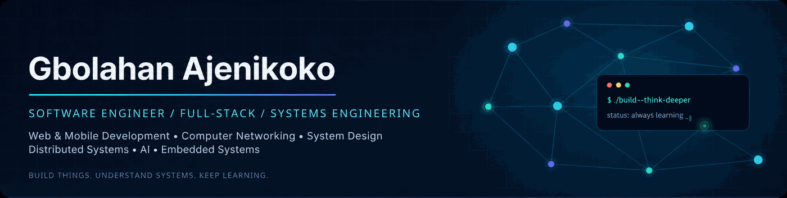

<div align="center">

  

  <h3>Hey there 👋, I'm Gbolahan</h3>

  <p><strong>Software Engineer | Computer Engineering | Systems Enthusiast</strong></p>

  <p><em>Building useful products, exploring complex systems, and understanding how software works beneath the surface.</em></p>

  <a href="https://github.com/ghasty003">
    
  </a>

  <a href="mailto:gbolahanajenikoko@gmail.com">
    
  </a>

  <a href="https://github.com/ghasty003?tab=repositories">
    
  </a>

  <br><br>

  

</div>

---

## 👨‍💻 About Me

I'm **Gbolahan Ajenikoko**, but you can call me **Ghasty**.

I'm a software engineer, passionate about building software and understanding the systems that power it.

I specialize in **full-stack web and mobile development**, with growing interests in **system design, backend engineering, computer networking, distributed systems, and low-level programming**.

I enjoy going beyond using frameworks to understand the engineering principles, protocols, architectures, and infrastructure that make modern applications work.

- 🔭 Building scalable backend systems, web and mobile applications.
- 🧠 Exploring **system design, distributed systems, and computer networking**.
- ⚙️ Interested in **operating systems, infrastructure, developer tools, and embedded systems**.
- 🌱 Deepening my knowledge of **C, C++, Java, and systems programming**.
- 🤖 Fascinated by **Artificial Intelligence and Machine Learning**.
- 🤝 Open to collaborating on interesting engineering projects.
- 💬 Ask me about **JavaScript, TypeScript, React, React Native, Node.js, Java, and backend architecture**.
- 📫 Reach me at **gbolahanajenikoko@gmail.com**.

---

## 🛠️ Technologies & Tools

### 💻 Programming Languages

<p align="left">
  
</p>

### 🌐 Frontend Development

<p align="left">
  
</p>

**Also working with:**
React Router • Responsive Design • State Management • UI Architecture

### 📱 Mobile Development

<p align="left">
  
</p>

**Technologies:**
React Native • Expo • Expo Router • Redux Toolkit • Native Device APIs • Push Notifications

### ⚙️ Backend Engineering

<p align="left">
  
</p>

**Technologies & Concepts:**

`Spring Boot` `REST APIs` `gRPC` `JWT`
`Authentication` `Authorization` `Microservices`
`Background Jobs` `API Security`

### 🗄️ Databases & Caching

<p align="left">
  
</p>

**Areas of Interest:**
Database Design • Indexing • Query Optimization • Transactions • Caching • Data Modeling

### ☁️ DevOps, Infrastructure & Cloud

<p align="left">
  
</p>

**Also working with:**

DigitalOcean • Reverse Proxies • Load Balancing • CI/CD • Deployment Pipelines • Infrastructure Fundamentals

### 🔧 Development Tools & Other Technologies

<p align="left">
  
</p>

**Additional technologies:**
Jest • D3.js • Chart.js • Webpack • Babel • Puppeteer

---

## 🧠 Engineering Knowledge & Interests

My interests extend beyond application development into the systems and infrastructure that support modern software.

| Engineering Area | Topics |
|---|---|
| 🏗️ **System Design** | Scalability, Load Balancing, Caching, Idempotency, Reliability, Multitenancy |
| 🌐 **Computer Networking** | TCP/IP, UDP, DNS, HTTP/HTTPS, ARP, Subnetting, Network Discovery |
| ⚡ **Distributed Systems** | Service Communication, Fault Tolerance, Message Queues, Consistency |
| 🗄️ **Database Engineering** | Indexing, Transactions, Query Optimization, Data Modeling, Backups |
| 🐳 **DevOps & Infrastructure** | Docker, Nginx, Reverse Proxies, CI/CD, Deployment, Monitoring |
| 🔐 **Security** | Authentication, Authorization, JWT, API Security, TLS Fundamentals |
| 💻 **Systems Programming** | C, Unix Processes, Memory Management, Operating Systems |
| 🔌 **Embedded Systems** | Microcontrollers, Hardware/Software Integration, Computer Architecture |
| 🤖 **Artificial Intelligence** | Machine Learning, AI Applications, Model Integration |

---

## 🚀 Featured Projects

Here are some of the projects I've built or worked on.

### 🌐 Open-Source Projects

| Project | Description | Technologies |
|---|---|---|
| [Lazy-Cookie](https://github.com/ghasty003/Lazy-Cookie) | Browser cookie management through a familiar storage-like API | JavaScript, TypeScript |
| [expressify-cli](https://github.com/ghasty003/expressify-cli) | CLI tool for bootstrapping Express.js projects | Node.js, TypeScript |
| [Hawky](https://github.com/ghasty003/Hawky) | Messaging application with voice and video calling features | MERN, TypeScript |

### 🧪 Engineering Projects & Experiments

<details>
<summary><b>📚 Explore my larger engineering projects</b></summary>

<br>

**🔖 Sift — Bookmark Management Platform**

A system for organizing and managing X/Twitter bookmarks.

- Java Spring Boot backend
- PostgreSQL database
- React web dashboard
- Chrome browser extension
- iOS Shortcut integration
- Node.js scraping service
- gRPC communication

**🚚 ParcelForge — Multi-Tenant Logistics Platform**

A logistics SaaS platform exploring complex business and backend architecture.

- Multi-tenant application architecture
- Spring Boot and PostgreSQL
- Redis integration
- Warehouse and shipment management
- Driver and vehicle management
- Route planning and dispatch systems

**🌐 NetworkScanner — Network Discovery Tool**

A TypeScript-based experiment for understanding local computer networks.

- Network interface discovery
- IPv4 subnet calculations
- ARP-based device discovery
- Local network monitoring concepts

**🧪 Veriq — System Design Testing Tool**

An engineering project focused on experimenting with and testing system design principles.

- Backend performance testing
- Reliability experiments
- Idempotency testing
- Scalability and architectural behavior

**💻 Unix Shell — Systems Programming**

A minimal Unix-style shell implemented in C.

- Command parsing
- Process creation with `fork()`
- Program execution using `execvp()`
- Process synchronization
- Dynamic memory management

*Some projects are experimental, in development, or maintained in private repositories.*

</details>

---

## 📊 GitHub Statistics

<div align="center">


</div>

### 🔥 Contribution Streak

<div align="center">


</div>

### 📈 Contribution Activity

<div align="center">


</div>

### 🏆 GitHub Achievements

<div align="center">


</div>

---

## 🌱 What I'm Currently Exploring

```text
Software Engineering
│
├── Backend & Distributed Systems
│   ├── System Design
│   ├── Scalability & Reliability
│   ├── Database Internals
│   └── Microservices Architecture
│
├── Computer Networking
│   ├── TCP/IP & Network Protocols
│   ├── Network Programming
│   ├── Network Security
│   └── Infrastructure
│
├── Low-Level Engineering
│   ├── C & C++
│   ├── Operating Systems
│   ├── Memory Management
│   └── Embedded Systems
│
└── Artificial Intelligence
    ├── Machine Learning
    ├── AI Applications
    └── Intelligent Systems
```

---

<div align="center">

### 💡 My Engineering Philosophy

*"Don't just learn how to use a technology. Understand why it works, how it works, and what happens when it fails."*

<br>

**Interested in building something together?**

I'm always open to interesting ideas, collaborations, and engineering discussions.

[](mailto:gbolahanajenikoko@gmail.com)

<br>

**Thanks for visiting! 👋**


</div>
